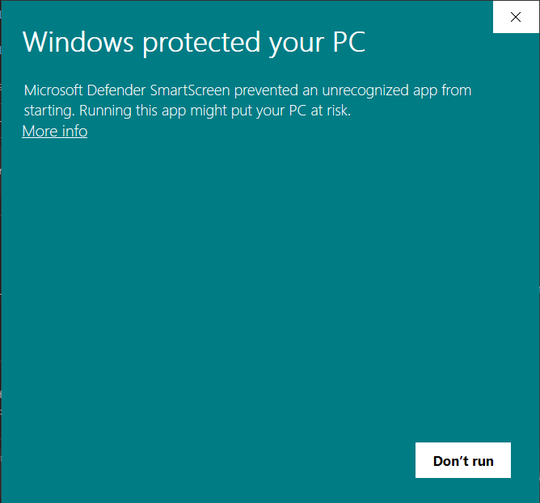
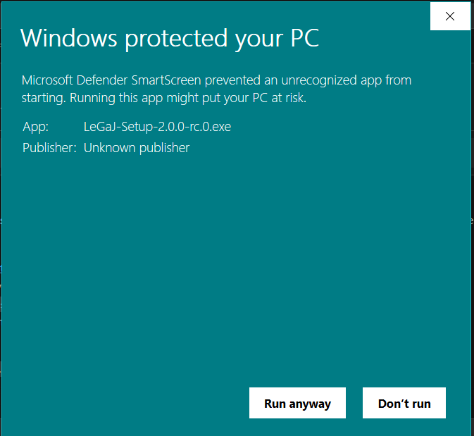

# Installing LeGaJ

LeGaJ runs on **Windows 10 and 11** (64-bit). It installs for your Windows account only, so it doesn't need an administrator password.

## 1. Download

From the [Releases page](https://github.com/bot-bbio/legaj/releases), download from the latest release:

- `LeGaJ-Setup-<version>.exe`, the installer;
- `LeGaJ-Setup-<version>.exe.sha256`, its SHA-256 checksum.

## 2. Check the download (optional, recommended)

In PowerShell, in your Downloads folder:

```powershell
(Get-FileHash .\LeGaJ-Setup-<version>.exe -Algorithm SHA256).Hash.ToLower()
Get-Content .\LeGaJ-Setup-<version>.exe.sha256
```

The two values must match. If they don't, delete the file and download it again.

## 3. Run the installer

LeGaJ is free and isn't signed with a paid code-signing certificate, so Windows SmartScreen shows a warning the first time:

1. Double-click `LeGaJ-Setup-<version>.exe`. A **"Windows protected your PC"** window appears.

   

2. Click **More info**. The window now shows the app name and "Publisher: Unknown publisher".
3. Click **Run anyway**.

   

The installer then:

- installs LeGaJ to `%LOCALAPPDATA%\Programs\LeGaJ` and adds it to the Start menu;
- installs Microsoft Edge WebView2 first, but only if your computer doesn't have it yet (most Windows 10 and 11 computers do);
- offers to start LeGaJ when it's done.

## 4. First run

A short setup asks for a Gemini API key (free from [Google AI Studio](https://aistudio.google.com/apikey)), your resume, and a quick review of your profile. You can skip any step and finish it later from the checklist at the top of the app. See [PRIVACY.md](PRIVACY.md) for what is sent to Gemini.

## Updating

When a new version is out, LeGaJ shows a banner with **Download** (unless you turned the update check off in Settings). Download the new installer and run it: your data is kept. Close LeGaJ first; the installer will ask you to if it's running.

## Uninstalling

Open **Settings › Apps › Installed apps**, find **LeGaJ** and choose **Uninstall**. It asks **"Keep your applications and documents?"**:

- **Yes** (the default) keeps your data in `%LOCALAPPDATA%\LeGaJ`, ready for a reinstall.
- **No** deletes that folder, LeGaJ's browser data and your saved Gemini key.
